<div align="center">

# OpenStation Max

**Открытая прошивка, голосовой ассистент «Алиса» (Gemini Live), Hi-Fi плеер Яндекс Музыки и веб-пульт для Яндекс Станции Макс (`yandexstation_2`)**

[-6c5ce7)](#)
[-00b894)](#)
[](#)
[-10b981)](#-полная-автономность-без-пк)
[](#-полный-откат-к-заводской-прошивке-яндекса)

*Полностью автономная прошивка для Яндекс Станции Макс v1.5.2: нативный аудио-стек Yandex VQE DSP с формированием луча по 7 микрофонам и эхоподавлением, голосовой ассистент «Алиса» с режимом автономного агента, 3D Halftone-визуализатор «3D Точки» и эстетика Apple tvOS × PS5 Spatial Glass, встроенный магазин приложений `OPENSTATION APPS`, установщик прошивки в 1 клик на базе `yasta_flasher`, защита от бутлупа и полная поддержка ревизий 0008, 00052 и 00053 (Zigbee 2023+).*

<br/>

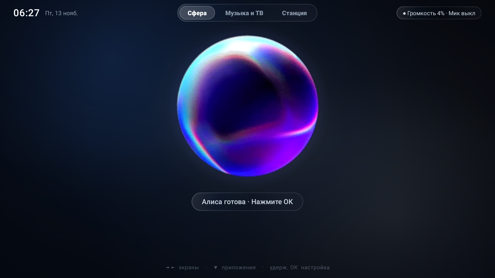

</div>

---

## 📸 Галерея интерфейса

### ТВ-лаунчер с морфингом живой сферы и оверлеем

Лаунчер выполнен в тёмной стеклянно-металлической эстетике (BORK × Duo Max) и состоит из трёх плавно переходящих экранов (**«Сфера» ↔ «Музыка и ТВ» ↔ «Станция»**). При переходе с главного экрана сфера плавно уменьшается и переезжает в нижний док-бар, а при вызове «Алисы» поверх YouTube или любого другого приложения выезжает системный оверлей.

<table>
  <tr>
    <td width="50%" align="center">
      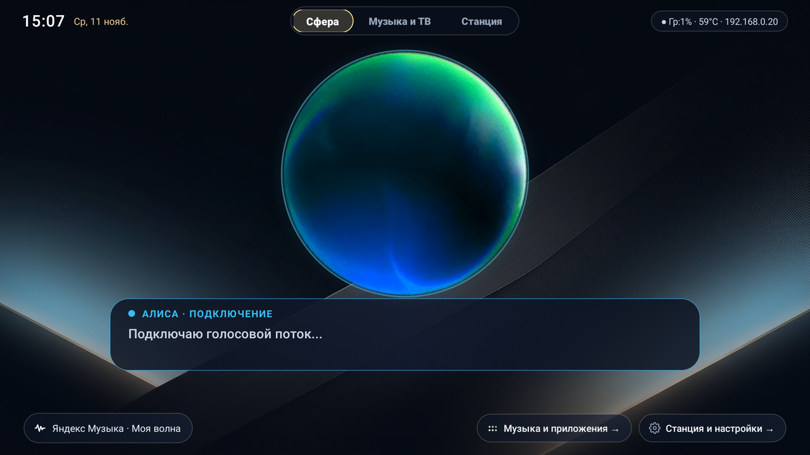
      <br/><sub><b>Сфера · Подключение / Слушает</b> — переливается в изумрудно-голубой при активации словом «Алиса»</sub>
    </td>
    <td width="50%" align="center">
      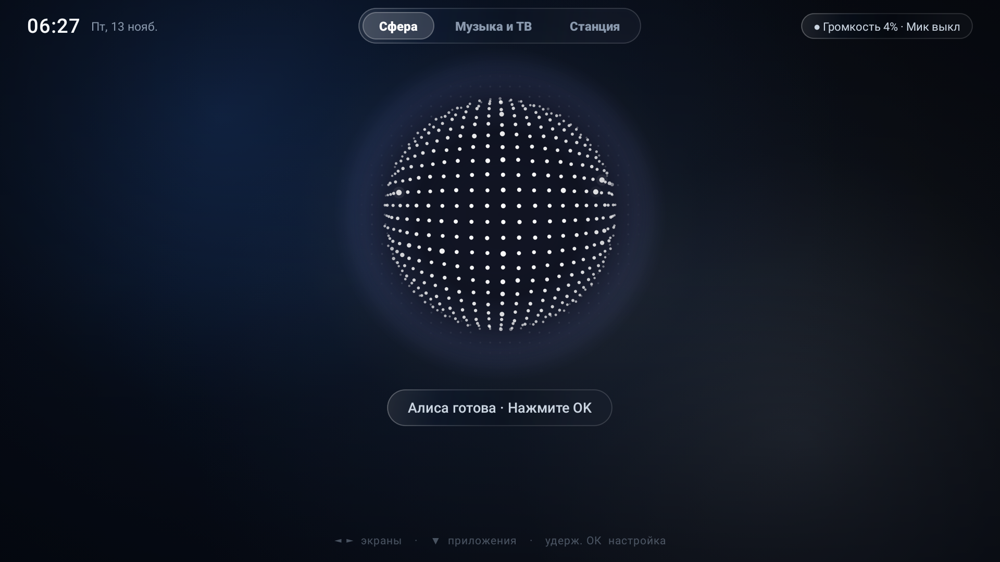
      <br/><sub><b>Сфера · Пульсация под музыку и голос</b> — цвет, скорость и амплитуда зависят от трека и речи</sub>
    </td>
  </tr>
  <tr>
    <td width="50%" align="center">
      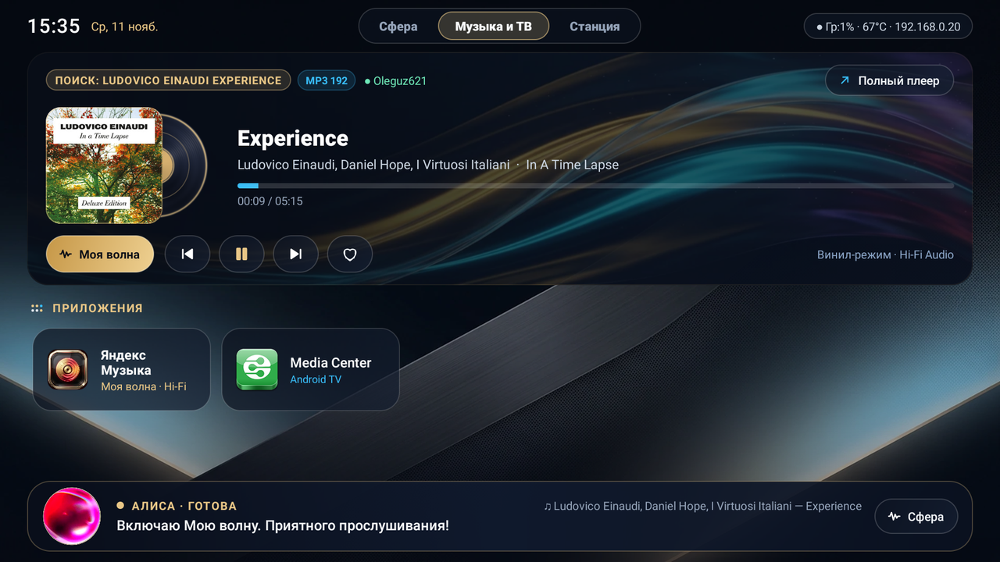
      <br/><sub><b>Экран «Музыка и ТВ»</b> — виниловая карточка плеера, обложки, приложения и сфера в нижнем доке</sub>
    </td>
    <td width="50%" align="center">
      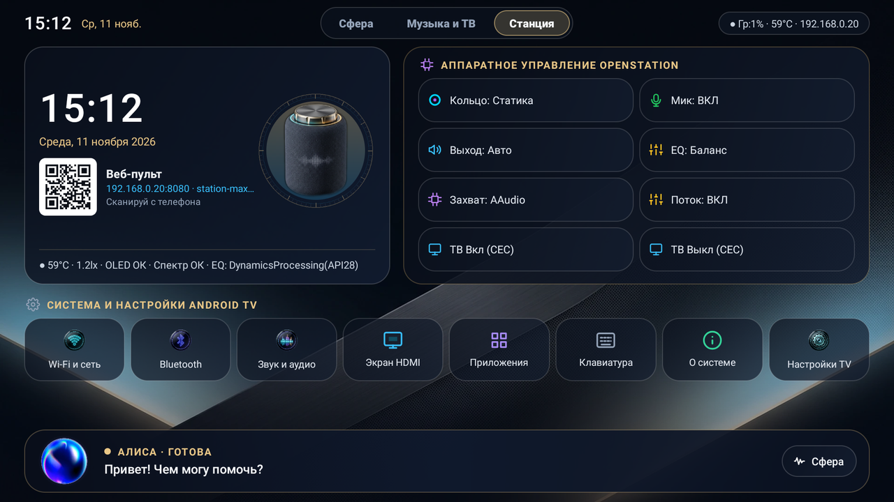
      <br/><sub><b>Экран «Станция»</b> — часы Duo Max, QR веб-пульта, 3D-рендер, управление железом и Android TV</sub>
    </td>
  </tr>
  <tr>
    <td width="50%" align="center">
      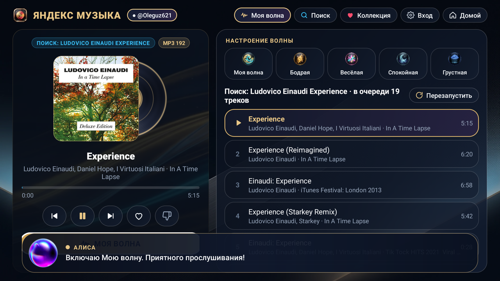
      <br/><sub><b>Полный плеер Яндекс Музыки</b> — Моя волна, 5 настроений, очередь треков, поиск и коллекция</sub>
    </td>
    <td width="50%" align="center">
      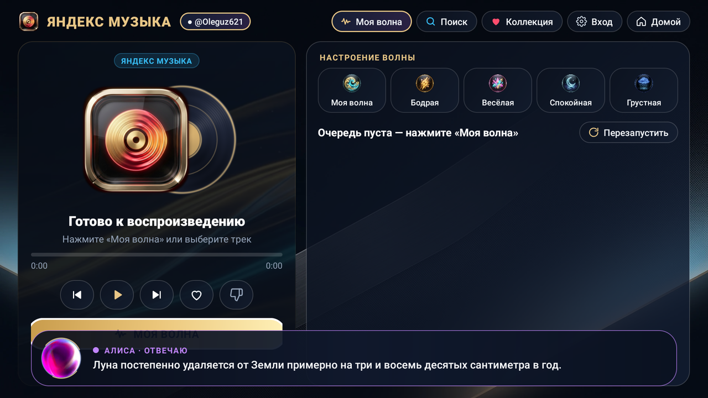
      <br/><sub><b>Системный оверлей поверх всех приложений</b> — сфера и текст ответа плавно появляются при вызове</sub>
    </td>
  </tr>
</table>

### Веб-пульт управления (`http://<IP-станции>:8080` / `station-max.local`)

Панель работает прямо со встроенного в колонку веб-сервера и мгновенно обновляется по WebSocket — на компьютере, планшете или телефоне (по QR-коду с экрана «Станция»).

Веб-пульт открывается мгновенно в локальной сети по адресу `http://<IP-станции>:8080` или `http://station-max.local:8080` — без ввода паролей и токенов. Сервер использует локальный HTTP без TLS, поэтому держите порт 8080 только внутри доверенной домашней сети.

<table>
  <tr>
    <td width="50%" align="center">
      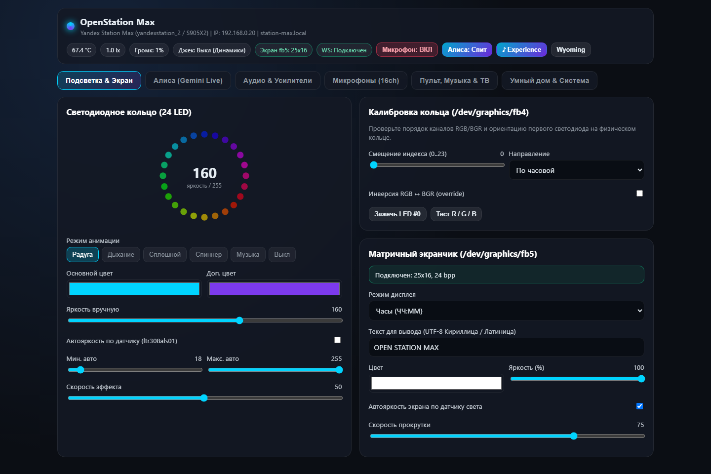
      <br/><sub><b>Подсветка &amp; Экран</b> — 24 RGB LED (радуга, дыхание, светомузыка, спиннер) и LED-матрица <code>fb5</code></sub>
    </td>
    <td width="50%" align="center">
      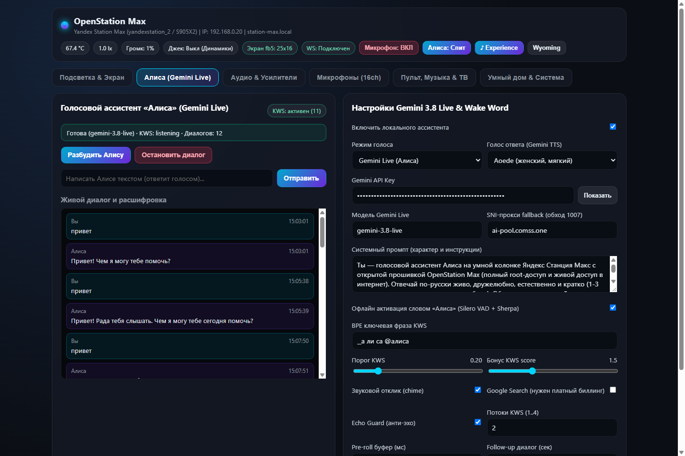
      <br/><sub><b>Алиса (Gemini Live)</b> — выбор голоса TTS, характер, обход блокировок, офлайн KWS и живой лог диалога</sub>
    </td>
  </tr>
  <tr>
    <td width="50%" align="center">
      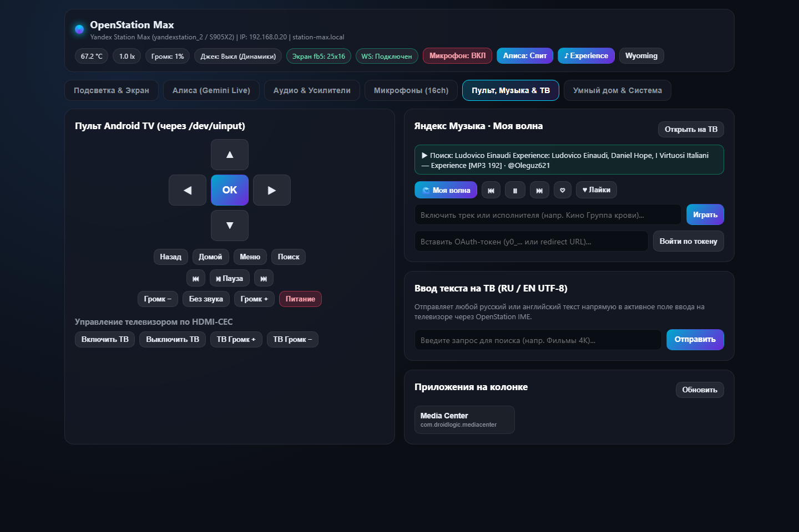
      <br/><sub><b>Пульт, Музыка &amp; ТВ</b> — D-Pad (<code>/dev/uinput</code>), кнопки HDMI-CEC, Моя волна, ввод RU/EN текста на ТВ</sub>
    </td>
    <td width="50%" align="center">
      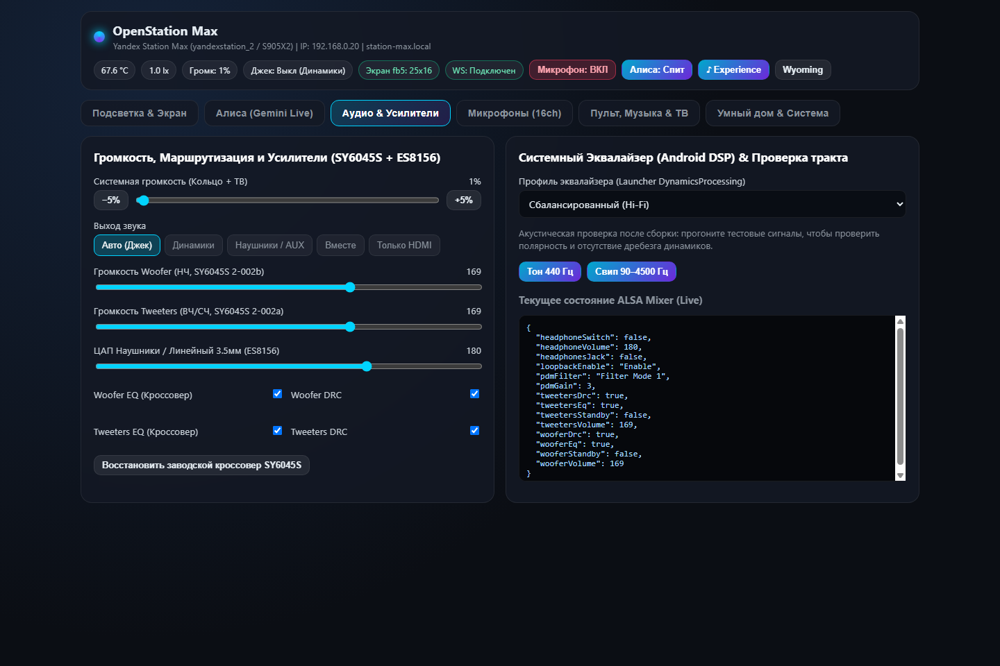
      <br/><sub><b>Аудио &amp; Усилители</b> — раздельные уровни НЧ/ВЧ (SY6045S), ЦАП 3.5мм (ES8156), EQ и живой ALSA Mixer</sub>
    </td>
  </tr>
  <tr>
    <td width="50%" align="center">
      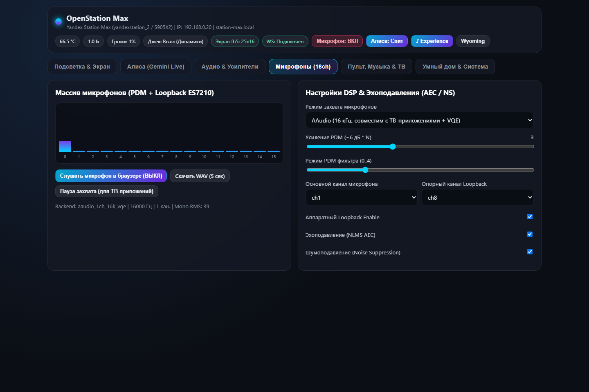
      <br/><sub><b>Микрофоны (16ch)</b> — RMS-уровни каналов PDM + loopback ES7210, NLMS AEC, прослушка в браузере</sub>
    </td>
    <td width="50%" align="center">
      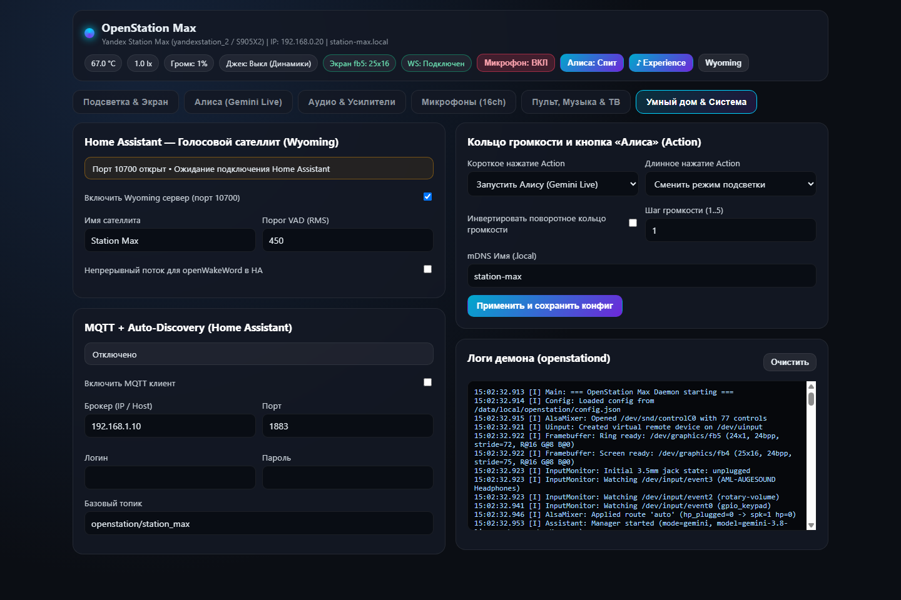
      <br/><sub><b>Умный дом &amp; Система</b> — Wyoming Satellite (<code>:10700</code>), MQTT Auto-Discovery, кнопки корпуса и логи</sub>
    </td>
  </tr>
</table>

<details>
<summary><b>📱 Мобильная версия веб-пульта (при сканировании QR-кода с экрана «Станция»)</b></summary>
<br/>
<table>
  <tr>
    <td width="50%" align="center">
      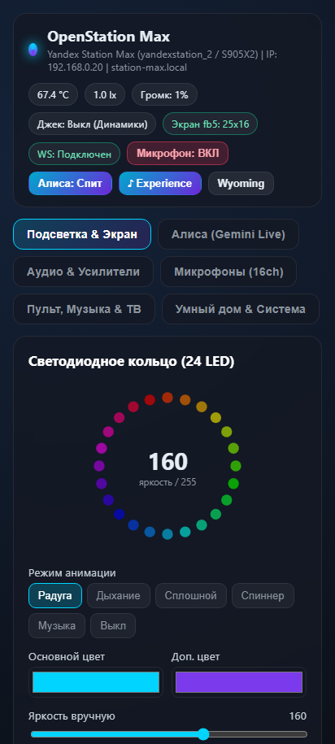
      <br/><sub>Управление кольцом со смартфона</sub>
    </td>
    <td width="50%" align="center">
      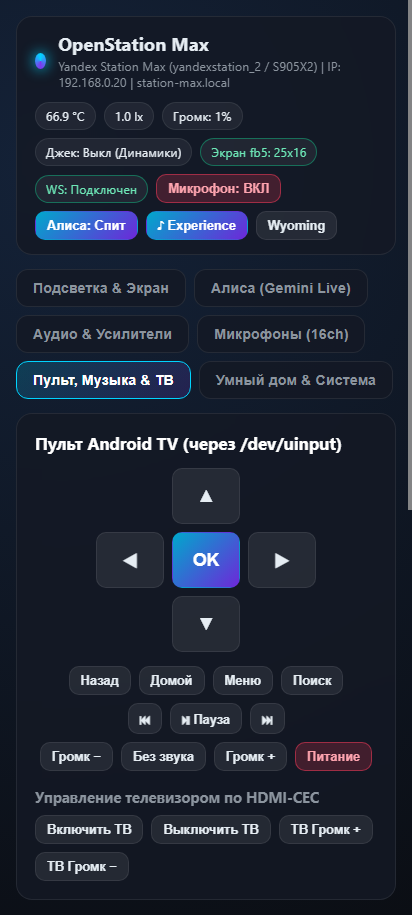
      <br/><sub>Сенсорный ТВ-пульт и громкость</sub>
    </td>
  </tr>
</table>
</details>

---

## ✨ Возможности

- **Голосовой ассистент «Алиса» на Gemini 3.8 Live:**
  - Полностью **офлайн** распознавание фразы «Алиса» на устройстве (`sherpa-onnx` + `silero_vad` + `ru-vosk-small`).
  - Живой двусторонний голосовой поток + 8 голосов на выбор (`Aoede`, `Kore`, `Leda`, `Zephyr`, `Puck`, `Charon`, `Fenrir`, `Orus`).
  - Умные инструменты (tool calling): включение музыки («Моя волна» или любой трек), управление Bluetooth, регулировка громкости, переключение EQ и режимов LED-кольца, будильники/таймеры, управление ТВ по HDMI-CEC, запуск Android-приложений, поиск в интернете и погода; произвольное выполнение root-команд ассистентом отключено.
  - Работающий из коробки **DNS `dns.comss.one`** (Private DNS Android) + SNI-fallback прокси `ai-pool.comss.one` для стабильной работы Gemini.
- **Режим Bluetooth-колонки (A2DP Sink):**
  - **Мгновенное сопряжение:** пятикратное нажатие на кнопку микрофона (`Mute`) или голосовая команда (*«Алиса, включи блютуз»* / *«Подключи телефон»*) переводит станцию в режим видимости как `OpenStation Max`.
  - **Прямой аудио-поток с телефона:** любая музыка, видео или подкасты с телефона воспроизводятся через раздельные усилители SY6045S и ЦАП ES8156 с полной мощностью Станции Макс (65 Вт).
  - **Индикация:** на матричном экране отображается «BT», LED-кольцо пульсирует синим цветом, звучит двухтональный сигнал и всплывает уведомление на экране ТВ.
- **Нативная Яндекс Музыка (XLam WebView + ExoPlayer Hi-Fi):**
  - Вход по своему аккаунту Яндекс (QR/код на ТВ или OAuth-токен), «Моя волна» с 5 настроениями, «Мне нравится», поиск любых треков/артистов, очередь, винил-карточка и проигрывание в фоне.
  - Работает по голосовой команде *«Алиса, включи музыку»* и с пульта/телефона.
- **Аппаратная интеграция Станции Макс (`openstationd`):**
  - **24 RGB LED-кольцо (`fb4`)** + автояркость по датчику света `ltr308als01`, кольцо громкости при вращении шайбы, красная пульсация при Mute.
  - **Матричный LED-экран (`fb5`, 25×16):** часы, бегущая кириллица, аудио-спектр, автоматическое определение отключённого шлейфа.
  - **Аудио-тракт:** раздельные усилители SY6045S (Woofer + Tweeters), ЦАП ES8156 (3.5 мм джек с автоопределением наушников), системный 10-полосный `DynamicsProcessing` эквалайзер и 24-полосный `Visualizer`.
  - **Физические органы управления:** поворотное кольцо громкости (`rotary-volume`), кнопка Action (`gpio_keypad`), кнопка Mute микрофонов.
- **Home Assistant и локальная сеть:**
  - Встроенный **Wyoming Satellite** (`TCP :10700`) и **MQTT Auto-Discovery**, mDNS `station-max.local`, собственная ТВ-клавиатура [`OpenStationIME`](ime/) с русско-английской раскладкой и вставкой текста с телефона.

---

## 🔋 Полная автономность (без ПК)

Компьютер нужен **только один раз — на момент прошивки** (`FLASH_OPENSTATION.bat`). После перезагрузки кабель можно отключать — вся система живёт и работает внутри самой Станции Макс:

- **Системный демон `openstationd` (C++):** автозапуск из `/vendor/bin/rc_local.sh`, встроенный HTTP/WebSocket-сервер (`:8080`), mDNS (`http://station-max.local:8080`), офлайн Wake Word `"Алиса"`, голосовой поток Gemini Live + SNI-fallback, Wyoming Satellite (`:10700`), MQTT, HDMI-CEC и управление железом.
- **Локальный музыкальный сервер и плеер:** нативный `ExoPlayer` + локальный сервер Яндекс Музыки (`127.0.0.1:18080`) прямо на Android внутри колонки.
- **On-device диагностика и управление:** смена Private DNS (`dns.comss.one`), тест Gemini Live прямо со станции, перезапуск демона и перезагрузка колонки с телефона или ТВ.

---

## 🖥 Установщик в 1 клик (`OpenStationFlasher.exe` / движок `yasta_flasher`)

Никаких многошаговых мастеров и ручных параметров — в окне программы ровно **одна кнопка «Проверить подключение и установить»** и живая индикация состояния:

<div align="center">
  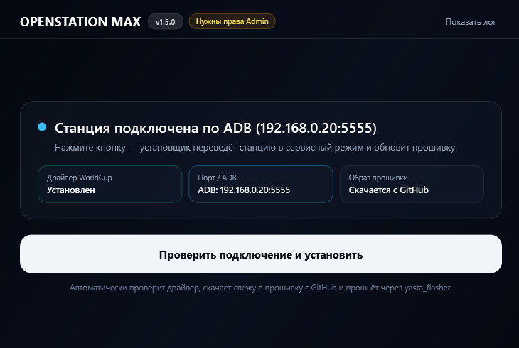
</div>

### Как работает автоматическая установка:
1. **Скачайте и запустите `OpenStationFlasher.exe`** из последнего релиза — установщик сам подтянет актуальные утилиты и свежий ROM (`v1.5.1`) с GitHub Releases, если их ещё нет на ПК.
2. **Подключите станцию** любым способом:
   - по **ADB** (установщик сам переведёт работающую станцию в сервисный USB Boot Mode), или
   - через **сервисный Type-C порт** с перемычкой на 6-й контакт (`BOOT` ↔ `GND`) и питанием 19V.
3. **Нажмите «Проверить подключение и установить»** — программа проверит/установит драйвер WorldCup, инициализирует U-Boot через изолированный загрузчик `yasta_flasher` (`pyamlboot_local` + нативный `update.exe bl2_boot` + `boot-g12.py` с проверкой `mmc dev 1`; ожидание USB-стека U-Boot до 40 секунд и защита от повторной загрузки BL2 в уже запущенный U-Boot), снимет защиту (`lock=10000000`, `avb2=0`, `silent=0`) и прошьёт актуальную систему (`logo`, `vbmeta`, `vendor`, `system`).
4. **Снимите перемычку (если ставили) и переподключите питание** — станция загрузится с новым логотипом и фирменной оболочкой Spatial Glass `v1.5.1`.

### Что исправлено в установщике v1.5.2
- **Зависание на 28% («Загрузка временного U-Boot...»)** — ожидание USB-стека U-Boot увеличено с 7.5 до 40 секунд, добавлены промежуточные статусы ожидания.
- **Повреждение сессии U-Boot** — станция, уже находящаяся в U-Boot, больше не определяется как BootROM: в неё не отправляются команды BootROM (`WR_LARGE_MEM`), из-за которых Windows показывала «Устройство не опознано». Режим определяется по ответу `identify`: `ROM 3.x / Stage 0.0` — BootROM, иначе — U-Boot.
- **`update.exe` не находил станцию** — исправлен сканер `AmlUsbScanX3.dll`: сбойный USB-контроллер (например, USB4/Thunderbolt) больше не прерывает поиск остальных контроллеров (патч 2 байта, см. [`scripts/patch_amlusbscan.py`](scripts/patch_amlusbscan.py)).
- **Автовосстановление USB** — при «залипшем» устройстве установщик сбрасывает порт и переподключает устройство, затем ещё раз проверяет `update.exe`.
- **ROM из предыдущего релиза** — если в последнем релизе нет ROM-архива (выпущен только фикс установщика), установщик берёт актуальный ROM из более раннего релиза.

---

## ⚡ Прошивка в 1 клик через ADB (`FLASH_OPENSTATION.bat`)

> Установка **не затрагивает загрузчик и системные разделы** — все оригинальные сервисы и политики Яндекса сохраняются в папку `backup/`, и в любой момент можно вернуться на заводскую прошивку батником [`ROLLBACK_STOCK.bat`](ROLLBACK_STOCK.bat).

### Что понадобится

1. **Яндекс Станция Макс (`yandexstation_2`)** с активным **root ADB** (по USB-кабелю Type-C ↔ ПК или по Wi-Fi `IP:5555`).
2. **Компьютер на Windows 10 / 11** *(только на 2 минуты прошивки — компиляторы и даже `adb` ставить заранее не обязательно!)*.
3. **Бесплатный API-ключ Google Gemini** *(делается за 1 минуту на [aistudio.google.com/apikey](https://aistudio.google.com/apikey) — можно ввести как в батнике, так и потом на ТВ/телефоне в Мастере настройки)*.

### Пошагово

1. Скачайте репозиторий (**Code → Download ZIP** вверху GitHub и распакуйте, либо `git clone https://github.com/Olegu621/OPENSTATION.git`).
2. Подключите Станцию Макс к ПК по USB Type-C *(или узнайте её IP в вашей Wi-Fi сети)*.
3. Запустите двойным кликом **[`FLASH_OPENSTATION.bat`](FLASH_OPENSTATION.bat)** и выберите:
   - **`[1]`** — автопоиск по USB и установка готовой проверенной прошивки из `firmware/`;
   - **`[2]`** — подключение по Wi-Fi (введите IP колонки, например `192.168.0.20`);
   - **`[3]`** — пересобрать всё из исходников (для разработчиков) и прошить.
4. Если на ПК ещё не установлен `adb.exe`, установщик **сам скачает** официальный Google Platform Tools в `tools\platform-tools\`, проверит контрольные суммы SHA-256 прошивки (`firmware/manifest.json`), сохранит сток в `backup/`, пропишет `Private DNS = dns.comss.one`, прошьёт все компоненты и перезагрузит колонку.
5. После перезагрузки **отсоедините ПК** — на экране телевизора автоматически откроется **Мастер настройки OpenStation**.

---

## 🔌 Полная прошивка через сервисный порт (`FLASH_SERVICE_PORT.bat`)

> Нужно для **чистой установки с нуля**, восстановления из **кирпича (unbrick)** или при отсутствии ADB. Оболочка (`OpenStationLauncher`, `OpenStationIME`, `openstationd`, модели KWS/VAD и Яндекс Музыка) полностью **вшивается внутрь разделов `system` и `vendor`** — работает даже после полного сброса `/data`. Загрузчик и уникальные разделы платы (`bootloader`, `boot`, `cri_data`) **не перезаписываются**.

### Схема 7-пинового сервисного разъёма

Разъём расположен на нижней стороне Станции Макс **под резиновой заглушкой возле радиатора**. Нумерация `1..7` идёт **со стороны разъёма AUX**:

```text
  [AUX]    1   2   3   4   5   6   7
           ■   ■   ■   ■   ■   ■   ■
           │   │   │           │
         DATA+ │  GND ─────────┘   <-- замкнуть 6 пин на 3 (GND)
             DATA-                     при подключении USB и питания!
```

1. Подключите USB-кабель от ПК к пинам **1 (`DATA+`)**, **2 (`DATA-`)**, **3 (`GND`)** *(линию питания +5V от USB НЕ подключать)*.
2. Замкните **6 пин** на **3 пин (`GND`)** для активации режима **Amlogic USB Boot (`VID_1B8E&PID_C003`)**.
3. Вставьте USB в ПК, подключите блок питания 19V к колонке и запустите **[`FLASH_SERVICE_PORT.bat`](FLASH_SERVICE_PORT.bat)**:
   - **`[1]`** — прошить `vbmeta` + `vendor` + `system` и очистить `/data` и `/cache` *(рекомендуется с нуля / после сбоя)*;
   - **`[2]`** — прошить системные разделы **без очистки `/data`** *(сохранить API-ключ и токены)*;
   - **`[3]`** — предварительно установить USB-драйвер **WorldCup (`service_flash\Drivers\`)** и прошить;
   - **`[4]`** — указать локальный архив `OpenStationMax-ROM-*.zip` вручную.
4. Скрипт сам проверит драйвер, при отсутствии скачает/найдёт **`OpenStationMax-ROM-v1.2.0.zip`** (с проверкой SHA-256 по [`rom/rom_manifest.json`](rom/rom_manifest.json)), загрузит U-Boot (`boot-g12.py -> aml.img`) и запишет разделы через `update.exe`.
5. **После завершения обязательно снимите перемычку 6↔3**, переподключите питание и подождите 60–90 секунд — сразу запустится OpenStation Max и **Мастер настройки ТВ ↔ телефон** *(свежие правки сразу прилетят по GitHub OTA)*.

<details>
<summary><b>🧱 Пересборка сервисных образов (`vbmeta.img`, `vendor.img`, `system.img`)</b></summary>

Для сборки своего релиза `OpenStationMax-ROM-vX.Y.Z.zip` (без WSL на Windows):
1. Поместите чистые разблокированные `vbmeta.img`, `vendor.img`, `system.img` от YAOSX 1.99 в папку `base_rom/` *(либо скрипт сам найдёт `Desktop\YAOSX\1.99`)*.
2. Подключите любую рабочую станцию с root ADB и выполните:
   ```powershell
   powershell -NoProfile -ExecutionPolicy Bypass -File .\scripts\build_service_images.ps1
   ```
3. Скрипт проверит SHA-256 `firmware/`, удалит блоатварь Яндекса из образов, вошьёт OpenStation (`OpenStationLauncher`, `OpenStationIME`, `/system/openstation/` с чистым шаблоном `config.default.json` без секретов, обновлённый `/vendor/bin/rc_local.sh`), выполнит `e2fsck -fy/-fn`, обнулит пустые блоки и соберёт архив в `dist/OpenStationMax-ROM-vX.Y.Z.zip` + `rom/rom_manifest.json`.

</details>

---

## ✨ Мастер настройки (на ТВ и на телефоне)

При первом включении (или в любой момент по кнопке **«✨ Мастер»** на вкладке **«Станция»** и в шапке веб-пульта) доступен пошаговый мастер из 5 этапов:

1. **Старт и связь:** проверка автономного сервера `:8080`, `station-max.local`, температуры SoC, матрицы `fb5` и статуса `Private DNS = dns.comss.one`.
2. **Алиса (Gemini Live + KWS):** вставьте ключ Gemini API с телефона (отсканируйте QR-код на левой панели -> откроется `http://<IP>:8080/#wizard`) или прямо пультом на ТВ, выберите голос/характер, прокси fallback, нажмите **«Проверить Gemini Live»** и скажите **«Алиса»** вслух для проверки микрофонов.
3. **Яндекс Музыка и звук:** вход в аккаунт Яндекса (по QR/коду на ТВ или OAuth-токеном в мастере с телефона), выбор маршрута выхода и эквалайзера, тест 440 Гц.
4. **Свет, кнопки и ТВ:** тест кольца LED (`fb4`), кнопки Action и проверки HDMI-CEC (вкл/выкл телевизора).
5. **Готово:** сохраняет настройку (`setupCompleted = true`) — при завершении с телефона мастер на ТВ закрывается автоматически и открывает главный экран с живой сферой.

---

## ☁ Обновления по воздуху (GitHub OTA)

После первоначальной прошивки подключать Станцию к ПК для обновлений больше **не нужно** — `openstationd` сам обновляет себя, ТВ-лаунчер (`OpenStationLauncher`) и клавиатуру (`OpenStationIME`) напрямую с GitHub:

- **Автоматическая проверка:** при запуске демон проверяет [`firmware/manifest.json`](firmware/manifest.json) на ветке `main` (`Olegu621/OPENSTATION`) и подсвечивает доступное обновление золотой кнопкой **«⬇ vX.Y.Z»** на экране **«Станция»** в ТВ-лаунчере и в шапке веб-пульта.
- **Обновление в 1 клик (с ТВ или телефона):** откройте **⬇ OTA** на ТВ-экране *«Станция»* или карточку **«Обновления прошивки (GitHub OTA)»** в веб-пульте (**Умный дом & Система**), чтобы посмотреть список изменений и запустить установку.
- **Строгая защита от сбоев:** проверяется модель устройства (`yandexstation_2`), свободное место на `/data`, точный размер и контрольная сумма **SHA-256** каждого файла, ZIP-заголовок APK и самотест нового `openstationd --version` до замены активных компонентов. Ваши ключи Gemini и сессия Яндекс Музыки (`config.json`) полностью сохраняются.

---

<details>
<summary><b>🛠 Ручная установка через PowerShell / сборка из исходников</b></summary>

1. Прошить готовую прошивку из `firmware/` без интерактивных вопросов (подставив свой ключ):
   ```powershell
   powershell -NoProfile -ExecutionPolicy Bypass -File .\scripts\deploy.ps1 -UseFirmware -GeminiApiKey "ВСТАВЬТЕ_ВАШ_КЛЮЧ_GEMINI"
   ```
   *(Для Wi-Fi добавьте `-DeviceSerial 192.168.0.20`; если ключ не передавать, укажете его позже в Мастере настройки).*

2. Пересобрать пакет `firmware/` (бинарник C++17 `openstationd`, `OpenStationLauncher.apk`, `OpenStationIME.apk`, `manifest.json` с SHA-256):
   ```powershell
   powershell -NoProfile -ExecutionPolicy Bypass -File .\scripts\build_firmware.ps1
   ```

3. Скрипт [`scripts/deploy.ps1`](scripts/deploy.ps1) и [`scripts/build_firmware.ps1`](scripts/build_firmware.ps1) автоматически ищут SDK в `ANDROID_HOME`, `%LOCALAPPDATA%\Android\Sdk` и `C:\Android`:
   - **JDK 17** (`winget install EclipseAdoptium.Temurin.17.JDK`)
   - **Android SDK** (`platforms;android-34`, `build-tools;34.0.0`) + **NDK r26c** (`26.3.11579264`)
   - **CMake 3.22.1+**, **Ninja**, **Gradle 8.5+**, **Python 3**

</details>

---

## 🎮 Как пользоваться каждый день

### Голосовые команды («Алиса»)

Просто скажите **«Алиса, ...»** (или нажмите верхнюю кнопку Action / микрофон на экране):

| Что сказать | Что произойдёт |
| :--- | :--- |
| *«Алиса, включи музыку»* / *«включи Мою волну»* | Нативно запустит вашу Мою волну в Яндекс Музыке прямо в лаунчере |
| *«Алиса, поставь Кино Группа крови»* / *«следующий трек»* / *«поставь лайк»* | Найдёт и включит трек, переключит или сохранит в коллекцию |
| *«Алиса, громче / сделай громкость на 40%»* | Изменит громкость с визуализацией на LED-кольце |
| *«Алиса, поставь фиолетовую подсветку»* / *«включи радугу»* | Переключит режим или цвет 24-светодиодного кольца |
| *«Алиса, выключи / включи телевизор»* | Отправит команду по HDMI-CEC подключённому ТВ |
| *«Алиса, какая погода в Москве?»* / *«найди в интернете...»* | Получит актуальные данные из интернета и кратко ответит |
| *«Алиса, поставь таймер на 10 минут»* | Запустит локальный таймер с уведомлением и сигналом |
| *«Алиса, открой настройки»* / *«домой»* | Откроет приложение или вернёт на главный экран **«Сфера»** |

### Навигация, пульт и веб-панель

- **Переключение 3 экранов на ТВ:** кнопками пульта **Влево / Вправо**, выбором вкладки вверху (**Сфера · Музыка и ТВ · Станция**), либо кнопками быстрого перехода внизу. В приложении/на 2-м и 3-м экране нажатие **«Сфера»** или кнопка «Домой» возвращает к большой живой сфере.
- **Веб-пульт на телефоне:** наведите камеру телефона на **QR-код** на вкладке **«Станция»** или откройте в браузере `http://<IP-станции>:8080` (либо `http://station-max.local:8080`).
- **Аппаратное кольцо и кнопки на колонке:** вращение кольца регулирует системную громкость (инверсия и шаг меняются в веб-пульте), кнопка **Mute** физически отключает микрофоны с красной индикацией кольца, короткое/долгое нажатие **Action** настраивается там же.

---

## ⚙️ Параметры `deploy.ps1` и интеграция с Home Assistant

Полезные флаги установщика [`scripts/deploy.ps1`](scripts/deploy.ps1):

- `-UseFirmware` — установить проверенные бинарники из локальной папки [`firmware/`](firmware/) с проверкой SHA-256 (используется в `FLASH_OPENSTATION.bat`);
- `-Interactive` — интерактивный мастер выбора USB/Wi-Fi устройства и опционального ввода ключа Gemini API в консоли;
- `-UsePrebuilt` — скачать готовый бинарник `openstationd` и APK из GitHub Releases;
- `-SkipBuild` — пропустить компиляцию и использовать собранные файлы в `daemon/build/` и `*/app/build/outputs/apk/`;
- `-DeviceSerial <id|IP>` — выбрать конкретную станцию (например `-DeviceSerial 192.168.0.20` или серийный номер ADB);
- `-GeminiApiKey "<ключ>"` — записать/обновить ключ Gemini API в `/data/local/openstation/config.json`;
- `-PrivateDnsHost "dns.comss.one"` — настроить Private DNS (передайте `""`, чтобы пропустить);
- `-NoReboot` — не перезагружать колонку автоматически в конце установки.

**Home Assistant:**
- **Голосовой сателлит (Wyoming Protocol):** добавьте в HA интеграцию *Wyoming Protocol* с адресом `<IP-станции>` и портом `10700`.
- **Датчики и управление (MQTT):** во вкладке **«Умный дом & Система»** веб-пульта включите MQTT и укажите адрес вашего брокера — сущности появятся в Home Assistant автоматически по Auto-Discovery.

---

## 🔄 Полный откат к заводской прошивке Яндекса

Просто запустите двойным кликом **[`ROLLBACK_STOCK.bat`](ROLLBACK_STOCK.bat)** *(или выполните команду PowerShell ниже)* — скрипт остановит `openstationd`, вернёт оригинальный `/vendor/bin/rc_local.sh`, восстановит `device_owner`, политики, клавиатуру, пакеты Яндекса и перезагрузит колонку:

```powershell
powershell -ExecutionPolicy Bypass -File .\scripts\rollback.ps1
```

Если нужно дополнительно полностью удалить установленные APK (`OpenStationLauncher`, `OpenStationIME`) и рабочую папку `/data/local/openstation`:

```powershell
powershell -ExecutionPolicy Bypass -File .\scripts\rollback.ps1 -UninstallApps
```

---

## ❓ Частые вопросы (FAQ)

- **Алиса отвечает ошибкой подключения / `1007`:** проверьте, что в настройках колонки активен `dns.comss.one` и в веб-пульте (**Алиса → SNI-прокси fallback**) указано `ai-pool.comss.one`, а также проверьте верность ключа Gemini API.
- **Нет звука или звук тихий после разборки / на наушниках:** в веб-пульте перейдите во вкладку **«Аудио & Усилители»** и выберите нужный режим маршрутизации (*Авто (Джек)* / *Динамики* / *Наушники / AUX* / *Вместе*) или нажмите *«Восстановить заводской кроссовер SY6045S»*.
- **Микрофон нужен другому приложению (например, YouTube/Звонок):** нажмите кнопку **«Пауза захвата»** на экране **«Станция»** или в веб-пульте (**Микрофоны 16ch**), либо переключите захват на режим **AAudio**.
- **Отключён шлейф переднего LED-экранчика:** поддерживается из коробки — `openstationd` определяет наличие дисплея `fb5` автоматически и работает без ошибок даже без него.
- **Нет ИК-управления телевизором:** на плате Станции Макс физически отсутствует ИК-передатчик, поэтому управление ТВ реализовано по **HDMI-CEC** (`/sys/class/cec/cmd`).

---

## 📁 Структура репозитория

```text
├── FLASH_OPENSTATION.bat  # Прошивка по ADB в 1 клик (SHA-256 проверка firmware/, USB/Wi-Fi)
├── FLASH_SERVICE_PORT.bat # Полная прошивка системных разделов через 7-пин сервисный порт / Unbrick
├── ROLLBACK_STOCK.bat     # Возврат на стоковую прошивку Яндекса в 1 клик
├── firmware/              # Бинарники для ADB/OTA (openstationd, Launcher/IME APK + manifest.json)
├── rom/                   # Манифест сервисных образов rom_manifest.json (+ распакованные .img локально)
├── service_flash/         # Инструменты Amlogic USB Boot: boot-g12.py, aml.img, update.exe, драйвер WorldCup
├── assets/                # Модели sherpa-onnx/Silero VAD (KWS), cacert.pem и пакет Яндекс Музыки (ym_app.tar.gz)
├── daemon/                # C++17 системный демон + автономный веб-сервер (LED, Audio, KWS, Gemini Live, Wyoming, MQTT)
├── docs/images/           # Скриншоты интерфейса ТВ, Яндекс Музыки и веб-пульта
├── ime/                   # Android TV клавиатура OpenStationIME (RU/EN + приём текста по UDP :8085)
├── launcher/              # Android TV лаунчер OpenStationLauncher (Мастер настройки, Сфера, оверлей, Музыка)
└── scripts/               # Установщики (deploy.ps1, flash_service_port.ps1), сборщики и откат
```
